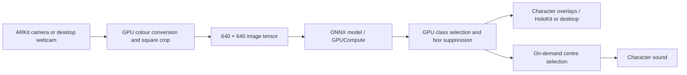

# Body Oracle

**Turn body poses into oracle-inspired characters with on-device AI and HoloKit.**

Body Oracle explores how a language of bodily gestures might change the way we notice and communicate with one another. Inspired by Chinese Oracle-Bone Inscriptions, the artwork imagines hieroglyphic signs for individual and collective bodily experiences. It invites people to explore movement as a form of language. Read about the broader artwork on the [project page](https://reality.design/project/body-oracle) and in [Body Oracle, TEI ’25](https://dl.acm.org/doi/10.1145/3689050.3707688).

This repository is a Unity application and a practical **AI + HoloKit example**. A camera observes body poses, a bundled neural network recognizes one of 20 classes, and the application places the corresponding character over the detected person. Select a person near the centre of the view to hear the character's associated sound. Run it with a webcam on macOS, or view the characters through HoloKit on iPhone.

The project page describes a broader generative artwork, including character generation and an archive. This Unity implementation uses a pretrained YOLO-style ONNX model and predefined character sprites and audio. Its runtime performs recognition and display; the generative training pipeline and archive are not included here.

[Project & video](https://reality.design/project/body-oracle) · [Paper](https://dl.acm.org/doi/10.1145/3689050.3707688) · [HoloKit SDK](https://github.com/holokit/holokit-unity-sdk) · [HoloKit guide](https://docs.holokit.io/)

## What HoloKit developers can learn

The example connects three parts of an AI-assisted AR experience: **AR Foundation supplies camera images, Unity Inference Engine runs the model locally, and HoloKit provides stereoscopic AR presentation**. The recognition path needs no cloud inference service or API key.

- Feed ARKit camera textures into an ONNX model, including colour conversion, cropping, and tensor preparation.
- Run inference and detection postprocessing on the GPU.
- Turn model outputs into character overlays in handheld mono and HoloKit stereo modes.
- Connect a recognized class to an interaction, such as playing its associated sound.
- Develop the same recognition pipeline with a desktop webcam before testing it on iPhone.

## Get started

### Requirements

- **Unity 6000.3.24f1 (6.3 LTS)**, matching [ProjectVersion.txt](ProjectSettings/ProjectVersion.txt).
- **For the desktop demo:** a Mac with a webcam and GPU support for compute shaders, instancing, and asynchronous readback. The current Mac player target is macOS 12 or later.
- **For HoloKit:** a HoloKit-compatible iPhone running **iOS 17 or later**, a HoloKit headset, a Mac with Xcode, and Unity's iOS Build Support module. Follow the [HoloKit guide](https://docs.holokit.io/) for hardware setup and compatibility.
- **For a standalone Mac build:** Unity's Mac Build Support module.

Dependencies are pinned in [Packages/manifest.json](Packages/manifest.json) and [Packages/packages-lock.json](Packages/packages-lock.json). Unity restores them when the project opens; the recognition model, character sprites, and audio are included.

### Open the project

```sh
git clone https://github.com/realitydeslab/bodyoracle.git
cd bodyoracle
```

In Unity Hub, add this directory as an existing project and open it with **6000.3.24f1**. Wait for package resolution and asset import to finish. If you use Unity CLI, you can also open it with:

```sh
unity open . --editor-version 6000.3.24f1
```

| Platform | Scene | Build profile | Capture |
| --- | --- | --- | --- |
| Mac | `Assets/Scenes/DesktopWebcam.unity` | `Mac` | Built-in, USB, or other desktop webcam |
| iOS | `Assets/Scenes/StereoscopicRendering.unity` | `iOS` | ARKit camera; mono or HoloKit stereo |

Use these application scenes under `Assets/Scenes`, rather than the SDK sample scene under `Assets/Samples`.

### Try it with a webcam

1. Open [DesktopWebcam.unity](Assets/Scenes/DesktopWebcam.unity). On its `Yolo` component, assign `Assets/Models/3-1-epoch120-last.onnx` to **Model Asset** if the field is empty, then save the scene. The current desktop scene needs this assignment before recognition can start.
2. Press **Play** in Unity, or build the `Mac` profile from **File → Build Profiles**.
3. Allow camera access. Select a webcam from the dropdown if needed, then stand far enough back for your whole pose to fit in the square preview.
4. Change your pose and watch the character overlay respond.
5. Centre a person under the crosshair and press **Space** or **Play character** to play their sound. Recognition resumes when playback finishes.

**Show camera** toggles the preview without interrupting recognition. The display and model use the same square crop, including camera rotation and vertical-flip correction; the preview is not horizontally mirrored.

If camera access is denied, enable it for Body Oracle (or Unity Editor) in **System Settings → Privacy & Security → Camera**, then restart. A missing or denied camera produces a status message instead of an exception.

### Run on iPhone and HoloKit

1. Open [StereoscopicRendering.unity](Assets/Scenes/StereoscopicRendering.unity). In **File → Build Profiles**, select and activate the **iOS** profile.
2. Build to an output directory such as `Builds/iOS`. Unity exports an Xcode project.
3. Open the exported project in Xcode. Choose your signing team and an appropriate bundle identifier, select your connected iPhone, and build and run.
4. Grant camera access. Start in handheld **Mono** mode and point the rear camera at someone whose body fits within the recognition view. Use **Pronounce** to hear the character associated with the detection nearest the centre.
5. Use the **Stereo** control to switch to HoloKit rendering, then mount the iPhone in HoloKit according to the headset guide. Have another participant try different poses while you observe the character overlays.

The iOS scene uses `HoloKitCameraManager` to switch rendering modes and adjusts the overlay parent between the main camera and HoloKit's centre-eye pose. Overlays are placed on a camera-relative projection plane; the model does not estimate each person's physical depth or create a world-anchored 3D body skeleton.

The iOS presentation pauses recognition after approximately 30 seconds without device movement when movement monitoring is enabled. Move the device to wake it, or disable **Enable Movement Monitoring** on `SpriteVisualizer` for a fixed-camera setup. ARKit capture and optical stereo alignment need a physical device; the desktop preview does not test these behaviours.

### Optional: build with Unity CLI

The commands in this README use a separately installed `unity` CLI. Unity Hub and the Editor workflow above do not require it.

```sh
unity build . --profile Mac --output-path Builds/Mac/BodyOracle.app --allow-dirty-build
unity build . --profile iOS --output-path Builds/iOS --allow-dirty-build
```

Each profile includes only its own scene. The iOS build exports an Xcode project; signing, deployment and physical HoloKit testing are separate from Unity export. Mac builds require Mac build support; iOS exports require iOS build support. Use `--allow-dirty-build` for local uncommitted work, or omit it for a clean checkout.

For a local Mac build, `bash Tools/build.sh mac` also repairs a stale copied App UI native plug-in signature, moves Unity CLI's provenance JSON outside the signed app bundle, and verifies the final signature. After a direct Unity CLI build, run `bash Tools/sign-mac-local.sh Builds/Mac/BodyOracle.app` for the same check. This only handles local ad-hoc builds; it refuses to replace a non-ad-hoc app signature. Distribution signing and notarization are separate.

Both profiles were built successfully with Unity CLI on 2026-09-21, with the resolved HoloKit 0.5.6 commit verified in each build's provenance. The Mac app is universal (Apple Silicon + Intel) and passes strict signature verification. The iOS artifact is an exported Xcode project, not a signed or device-tested IPA. Build logs retain package shader warnings; there were no C# or shader compilation errors.

The editor command below can regenerate the desktop scene and profiles from the iOS scene's existing character/audio assignments. It **overwrites the desktop scene**, so use it deliberately after preserving any scene edits:

```sh
unity run . -- -executeMethod BodyOracleProjectSetup.CreateDesktopScene
```

## How the AI pipeline works



1. Camera textures are converted/cropped/resized on the GPU to the 640 × 640 input tensor.
2. The original ONNX weights are preserved. `BodyOracleModel` specializes and optimizes the graph for `[1, 3, 640, 640]` once at startup; fixed shape expressions become constants.
3. Inference runs through Unity Inference Engine's GPUCompute backend.
4. Compute shaders read the channel-major output directly, classify 8,400 candidates, apply thresholds, perform exact greedy class-agnostic NMS, project the boxes, and select the centre detection.
5. GPU-written indirect draw arguments and detection buffers drive character sprite meshes. Platforms without indirect drawing use fixed-capacity procedural instancing, with the GPU rejecting unused slots. C# creates the static meshes once; no per-detection GameObjects, per-frame tensor download, CPU transpose, CPU sort, or CPU NMS remain.

The bundled demo model is [3-1-epoch120-last.onnx](Assets/Models/3-1-epoch120-last.onnx), referenced by the iOS scene and used for the desktop setup above. Its input is `[1, 3, 640, 640]` in NCHW layout, and its output is `[1, 75, 8400]`: 4 box channels, 20 class scores, and 51 keypoint channels. The current character display uses boxes and classes; it does not render the keypoints.

“GPU” refers to image processing, neural inference, detection postprocessing, and detection-dependent rendering. Unity still uses the CPU for camera callbacks, command submission, UI, audio, and application lifecycle. Clicking the sound button requests **one asynchronous 48-byte centre record**, holds inference until the callback, and then plays audio for that frame. No detection readback runs during normal recognition. A nonblocking graphics fence avoids queueing new inference while the preceding GPU frame is unfinished on devices that support both fences and asynchronous compute; other platforms keep work ordered on the graphics queue.

The default output capacity is **128 detections**, configurable on `Yolo`. When more survive, the highest-confidence 128 are kept and metadata word 2 indicates truncation. Equal scores use the original candidate index for deterministic ordering. There is no pre-NMS top-K approximation.

Thresholds preserve the original behaviour: scores below `conf_human` are discarded; scores below the class-specific threshold become class 18. NMS now uses actual intersection-over-union > 0.6. The old `boxBArea / intersectionArea > 0.8` condition erroneously suppressed virtually every overlapping/touching pair and has been removed. Centre selection is refreshed even for zero or one result.

The former synchronous CPU detection list/event API has been replaced with `GpuResults` and `RequestCenterDetection`. Both included presentations use the new APIs.

## Use this example in your own HoloKit project

Start by duplicating the iOS application scene so its camera references, materials, and mono/stereo UI remain connected. The main extension points are:

| Component | Responsibility | What to change |
| --- | --- | --- |
| [Yolo.cs](Assets/Scripts/Yolo.cs) | Camera input, preprocessing, inference scheduling, and centre selection | Model asset, thresholds, camera handling, and projection settings |
| [BodyOracleModel.cs](Assets/Scripts/BodyOracleModel.cs) | Loads and specializes the ONNX graph | Input shape and graph setup for a different model |
| [GpuYoloPostprocessor.cs](Assets/Scripts/GpuYoloPostprocessor.cs) and [YoloPostprocess.compute](Assets/Resources/YoloPostprocess.compute) | Decode predictions, remove duplicate boxes, and select the centre detection | Output layout, class count, confidence rules, and selection logic |
| [GpuSpriteRenderer.cs](Assets/Scripts/GpuSpriteRenderer.cs) and [BodyOracleSprites.shader](Assets/Resources/BodyOracleSprites.shader) | Draw character meshes using GPU detection buffers | Visual appearance and placement |
| [SpriteVisualizer.cs](Assets/Scripts/SpriteVisualizer.cs) | HoloKit presentation, sound, and movement monitoring | Character/audio assignments and iOS interaction |
| [DesktopOracle.cs](Assets/Scripts/DesktopOracle.cs) | Webcam preview, camera selection, and desktop controls | Desktop prototyping interface |

### Change the visual or audio response

On `SpriteVisualizer` for iOS, or `DesktopOracle` for desktop, replace entries in **Class Sprites**, **Sound Sprites**, and **Sound Clips**. Keep their array indices aligned with the model's class IDs, `0–19`. Changing these assets changes the response to a recognized class; teaching the model new poses requires a separately trained model.

### React to a recognized pose

For a button-driven interaction, request the centre detection from the `Yolo` component. For example, inside a method on your own component, where `detector` is an assigned `Yolo` reference:

```csharp
bool requested = detector.RequestCenterDetection((found, pose) =>
{
    if (!found) return;
    int classId = pose.predictedClassId;
    Debug.Log($"Selected Body Oracle class: {classId}");
    // Trigger your interaction using this class ID.
});
// false means no request was scheduled, e.g. no frame or a request is pending.
```

Use this on interaction rather than every frame. The callback runs asynchronously; account for your component being disabled or destroyed while it is pending. For continuous visuals, follow `GpuSpriteRenderer` and consume `GpuResults` on the GPU.

### Adapt the model

The decoder is specific to this model: a 640 × 640 input, 20 classes, channel-major output, and boxes expressed in input-image pixels. Class 18 is also used as a low-confidence fallback. Replacing the ONNX file alone is only sufficient if the new model preserves those conventions and class meanings. For a different detector, update preprocessing, the output decoder, class-dependent buffers and rendering loops, and sprite/audio mappings together, then rerun validation.

For overlay alignment, inspect **Projection Plane Height** and **Projection Plane Offset** on `Yolo` and **Projection Plane Distance** on `SpriteVisualizer`. Test both mono and stereo modes on the target iPhone. If an interaction needs physical depth, add an appropriate depth or spatial-tracking method.

## Validation

```sh
unity run . -- -executeMethod BodyOracleGpuValidation.Run -logFile Logs/gpu-validation.log
```

Run with graphics enabled (do **not** use `-nographics`). The validator uses a real Metal device and compares GPU postprocessing to an independent CPU reference for empty/single frames, threshold boundaries, greedy suppression chains, equal-score ties, touching boxes, invalid predictions, 8,400 candidates, capacity limits, and buffer reuse. It checks pixels for both indirect and fixed-capacity procedural rendering, including stale-slot rejection, and runs the actual scene model, asserting zero runtime CPU fallback layers. Test-only readbacks are intentional. Results are written to `Logs/gpu-validation.txt`, `Logs/gpu-sprite-test.png`, and `Logs/gpu-sprite-procedural-test.png`.

The validators live in `Assets/Tests/Editor/`, so they are excluded from players. Scene generation and build utilities live separately in `Assets/Editor/`.

Rendering validation uses four different corner colors to detect inverted or mirrored sprites. The offscreen video compositor passes Unity's projection matrix directly to `CommandBuffer.SetViewProjectionMatrices`; pre-converting it with `GL.GetGPUProjectionMatrix` caused an extra vertical flip on Metal. The orientation regression fails with that old projection and passes with the corrected one.

### Human-pose video replay

Install `ffmpeg`, then replay a video through the actual model, GPU postprocessing and character renderer:

```sh
bash Tools/fetch-test-videos.sh /tmp/bodyoracle-test-videos
bash Tools/test-pose-video.sh /tmp/bodyoracle-test-videos/pose_1.mp4 Logs/pose-video-1
bash Tools/test-pose-video.sh /tmp/bodyoracle-test-videos/pose_squats.mp4 Logs/pose-video-squats
```

The script decodes every frame outside Unity, then uses Unity CLI to run `BodyOracleVideoValidation.Run`. Each result directory contains a JSON report, per-frame detection CSV, rendered PNG overlays, source metadata and SHA-256 hash. Test decoding and synchronization are instrumentation, not the live webcam path. The public source videos are [TensorFlow.js pose-detection test fixtures](https://github.com/tensorflow/tfjs-models/tree/master/pose-detection/test_data).

Recorded validation on Unity 6000.3.24f1 / Apple M1 Max:

| Clip | Frames processed | Frames with detections | CPU/GPU comparisons | Original/optimized model comparisons |
| --- | ---: | ---: | ---: | ---: |
| `pose_1.mp4` | 120 | 118 | 13 passed | 3 identical |
| `pose_squats.mp4` | 65 | 65 | 8 passed | 3 identical |

No frame exceeded detection capacity, and the optimized model had zero runtime CPU fallback layers. The synthetic GPU validation also passed. These clips have no ground-truth character labels, so detection counts are not character classification accuracy. Timing includes GPU synchronization and startup; it is not a live-camera FPS benchmark. Physical webcam recognition quality, iPhone thermal performance, and optical stereo alignment still require device testing.

### iOS video replay and device validation

The replay test uses Unity `VideoPlayer` to deliver successive RGB video frames to the same GPU preprocessing, inference, postprocessing and sprite rendering used by the webcam path. It retains the iOS scene's character/audio mappings and Read-button listener. It verifies detection output, audio selection, inference pause during audio, and inference resume before advancing to the second video. Video continues playing while inference pauses, matching a live camera and avoiding a native iOS playback stall observed when pausing and resuming the video around audio selection. This is an application-level simulated camera; it does not emulate ARKit camera hardware or HoloKit head tracking.

Put `pose_1.mp4` and `pose_squats.mp4` in `Logs/simulator-inputs`, then run:

```bash
python3 Tools/test-ios-simulator.py
```

The script exports with Unity CLI, builds with Xcode, installs into an available iPhone Simulator, and saves its JSON report, screenshots, console logs and recording under `Logs/ios-simulator/`. `--video-dir PATH` selects another directory containing the two fixtures; `--skip-build` reruns an existing native build.

For a paired, unlocked iPhone with Developer Mode enabled and a valid Apple development signing team:

```bash
xcrun devicectl list devices
python3 Tools/test-ios-device.py --device IPHONE_UDID --mode replay --team APPLE_TEAM_ID
python3 Tools/test-ios-device.py --device IPHONE_UDID --mode camera --team APPLE_TEAM_ID
```

Replay installs a separate `org.realitydeslab.body-oracle.replay` test app. Camera validation builds the original iOS scene using its normal bundle identifier, so it updates that app if already installed. Allow camera permission and point the rear camera at a person. The camera test reports ARKit session state, processed frames and sampled detection counts; it also saves the screen and actual cropped model input. Its pass criterion is camera/GPU pipeline operation, not classification accuracy. Results go to `Logs/ios-device-replay/` and `Logs/ios-device-camera/`.

Validation scripts live in `Assets/Tests/`. Runtime harnesses are compiled only into explicit test builds. Replay media is staged into StreamingAssets during export and removed afterwards; XR loader, SDK and bundle settings are restored. Simulator exports omit device-only libraries. The simulator-only head-tracking bridge aborts if accidentally called, so unsupported tracking cannot silently appear to work. `BodyOracleXcodeProject` removes HoloKit's obsolete `-ld64` linker flag from generated Xcode projects. App UI is an editor dependency of Inference Engine; the application itself uses UGUI. `ConfigureRuntimePackages` enables the package's supported `APP_UI_EDITOR_ONLY` define for Mac and iOS to omit the unused managed runtime and avoid a mobile EnhancedTouch initialization error observed with App UI 1.3.6 / Input System 1.20. The device runner also inspects console exceptions emitted before the runtime test harness starts, and refuses to launch while another application's devicectl console test is using the same phone.

Verified on 22 September 2026 with Unity 6000.3.24f1:

| Target | Test | Collected result |
| --- | --- | --- |
| iPhone 17 Pro / iOS 26.5 Simulator | Two human-pose video clips | Passed; 62 + 62 processed frames, detections in 11 of 12 sampled frames; GPU procedural rendering |
| Physical iPhone 17 Pro / iOS 27, Apple A19 Pro | Same video clips | Passed; 62 + 65 processed frames, detections in all 12 sampled frames; GPU indirect rendering |
| Same physical iPhone | Original ARKit camera scene | Passed pipeline smoke test; 1,514 frames in 30.06 seconds, `SessionTracking`, camera permission granted |

Both replay runs passed audio selection and inference pause/resume on the first clip, with no runtime errors. Screenshots confirm upright video and character overlays. Counts are sampled pipeline results, not labelled recognition accuracy or performance benchmarks. The physical camera was pointed at the floor and nearby objects; some objects triggered character detections. This is an observed false-positive limitation, and the camera run does not establish correct recognition of people. HoloKit optical alignment and sustained device thermal performance remain unvalidated.

Evidence is in `Logs/ios-simulator/`, `Logs/ios-device-replay/`, and `Logs/ios-device-camera/`: each contains `report.json`, console logs and screenshots. The simulator also has `replay.mp4`. The connected physical iPhone rejected devicectl screen recording as an unsupported capability, so its evidence consists of screenshots and reports; see `recording.log`. The camera directory also contains `Documents/camera-model-input.png`. GPU regression tests passed for both draw paths, including asymmetric orientation, stale-slot rejection, and zero runtime CPU fallback layers in the optimized model.

## Package baseline

Unity's 6.3.24f1 migration updated registry dependencies to its recommended versions, including Inference Engine 2.6.1, URP 17.3.0, AR Foundation/ARKit 6.3.5, Input System 1.20.0, Burst 1.8.30, and Collections 2.6.8. Built-in packages retain their editor-defined versions. HoloKit 0.5.6 is pinned to commit `ab9560e75656bb5a27ac901983d5609da3b6eb87`. Unity Pipeline 0.7.0-exp.1 enables Unity CLI editor commands; player control is not configured.

## Credits and citation

Body Oracle is a project by **Ke Huang, Danlin Huang, Cun Lin, and Botao Amber Hu**. The [project credits](https://reality.design/project/body-oracle) list Ke Huang as director, Danlin Huang for visual design, Cun Lin as advisor, and Botao Amber Hu for speculative concept design.

If you refer to the artwork in research, cite:

> Ke Huang, Danlin Huang, Cun Lin, and Botao Amber Hu. 2025. Body Oracle. In *Proceedings of the Nineteenth International Conference on Tangible, Embedded, and Embodied Interaction* (TEI ’25). Association for Computing Machinery. https://doi.org/10.1145/3689050.3707688

```bibtex
@inproceedings{huang2025bodyoracle,
  author    = {Huang, Ke and Huang, Danlin and Lin, Cun and Hu, Botao Amber},
  title     = {Body Oracle},
  booktitle = {Proceedings of the Nineteenth International Conference on Tangible, Embedded, and Embodied Interaction},
  series    = {TEI '25},
  year      = {2025},
  publisher = {Association for Computing Machinery},
  doi       = {10.1145/3689050.3707688},
  url       = {https://doi.org/10.1145/3689050.3707688}
}
```
