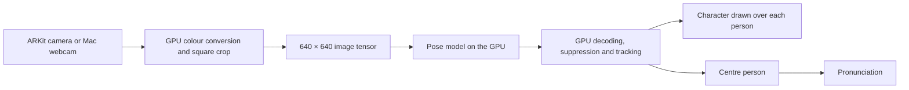

# Body Oracle

**On-device AI on HoloKit: a fine-tuned YOLO pose model runs in real time on the iPhone and turns people's poses into oracle-bone-inspired characters in mixed reality.**

Body Oracle is an artwork about how a language of bodily gestures might change the way we notice and communicate with one another. Look at someone through an iPhone, handheld or mounted in a [HoloKit](https://holokit.io) headset: a neural network on the phone recognises which of 20 poses they are holding, places the matching character over them, and speaks it aloud. The work has been published at TEI, Expanded and SIGGRAPH Asia, and exhibited at the IJCAI and CVPR art galleries, among others (see [Art and research](#art-and-research)).

This repository is the complete, open Unity app: the "Translator" of the installation. It is meant as a **reference for building on-device AI on HoloKit**, by hand or [with an AI coding agent](#use-it-as-a-reference-for-vibe-coding).

[Project & video](https://reality.design/project/body-oracle) · [Papers](#art-and-research) · [Releases](https://github.com/realitydeslab/bodyoracle/releases) · [Changelog](CHANGELOG.md) · [HoloKit Unity SDK](https://github.com/holokit/holokit-unity-sdk)

| | |
| --- | --- |
| **Current version** | **0.3.0** (iOS build 6) — [what's new](CHANGELOG.md#030) |
| **Runs on** | iPhone with iOS 17 or later, handheld or in a [HoloKit](https://holokit.io) headset · Mac with macOS 12 or later and a webcam |
| **Model** | YOLOv8n-pose fine-tuned on 20 Body Oracle poses (ONNX), 97.3 % top-1 accuracy on held-out test images, run on the GPU by Unity Inference Engine |
| **Built with** | Unity 6000.3.24f1 · [HoloKit Unity SDK](https://github.com/holokit/holokit-unity-sdk) 0.6.0-preview.1 · AR Foundation / ARKit 6.4.3 · Unity Inference Engine 2.6.1 |
| **Privacy** | Recognition runs entirely on the device. No account, no network requests, no data collected. |
| **App code** | [`Packages/org.realitydeslab.body-oracle`](Packages/org.realitydeslab.body-oracle) |

## What this example shows

- **On-device AI, no cloud.** A YOLO pose model (ONNX) runs on the iPhone's GPU through Unity Inference Engine, five times a second, with no server, API key or network connection.
- **Camera to model on the GPU.** ARKit camera frames are converted, cropped and turned into the model's 640 × 640 input tensor without passing through the CPU.
- **YOLO postprocessing on the GPU.** Compute shaders decode the 8,400 candidates, run non-maximum suppression, track people across frames and pick the person in the centre.
- **AI output in mixed reality.** Each recognised pose becomes a character drawn over the person, in handheld Mono AR or in HoloKit's stereoscopic Stereo mode.
- **A shipping app.** The same project builds a Mac version, has GPU and on-device validation tests, and has a scripted TestFlight release path.

Replace the model, the characters and the sounds, and the same structure fits other on-device detection or pose apps on HoloKit (see [Use this in your own HoloKit project](#use-this-in-your-own-holokit-project)).

## Using the app

### On iPhone

1. Open **Body Oracle** and allow camera access. Hold the phone in landscape.
2. Point the rear camera at a person about 2–3 m away, so their whole body fits inside the grid ("Place people in the middle of the grid.").
3. Their pose turns into a character drawn over them. **Hold a pose for one second** to hear the character; its pronunciation appears above the grid and is highlighted as it is spoken. Keep holding for three more seconds to hear it again, or tap **Pronounce** at any time.
4. Tap **Stereo** and put the iPhone in a HoloKit headset to see the characters in stereoscopic AR; tap **Mono** to return. Both modes use the same buttons.

Good to know:

- **Silent Mode mutes the pronunciation.** Turn Silent Mode off on the iPhone to hear it.
- In Mono, the app pauses after about 30 seconds without the phone moving, to save power. Move the phone to wake it. Stereo never pauses.
- **Start Recording** records the screen and microphone and saves the video to Photos.

### On a Mac

1. Open the Mac build (or press **Play** in Unity in the `DesktopWebcam` scene) and allow camera access. The first camera macOS reports is used.
2. Stand inside the grid, far enough back for your whole body to fit. Hold a pose for one second, or press **Space**, to hear its character.
3. **View → Enter Full Screen** (Control-Command-F) fills the display; **Esc** leaves full screen. Press **D** to outline the square the model actually sees.

If camera access was denied, enable it for Body Oracle (or the Unity Editor) in **System Settings → Privacy & Security → Camera**, then restart the app.

## Versions

Releases are git tags (`vX.Y.Z`) with notes on the [Releases page](https://github.com/realitydeslab/bodyoracle/releases); [CHANGELOG.md](CHANGELOG.md) lists every change. The version number (`bundleVersion`) follows semantic versioning. The iOS build number only ever increases, across versions, because App Store Connect requires a new one for every upload.

| Version | Date | iOS builds | HoloKit Unity SDK | Highlights |
| --- | --- | --- | --- | --- |
| [0.3.0](https://github.com/realitydeslab/bodyoracle/releases/tag/v0.3.0) | 2026-10-12 | 5 (TestFlight), 6 (App Store) | 0.6.0-preview.1 | Hold a pose to hear it, karaoke-style pronunciation, 3D guide grid, Stereo with the app's own buttons at 60 fps, zero-copy Mac camera, app moved into an embedded package |
| [0.2.1](https://github.com/realitydeslab/bodyoracle/releases/tag/v0.2.1) | 2026-09-22 | 3 (TestFlight) | 0.5.6 | Pose model retrained without the mirror flip, GPU temporal stabilisation, first TestFlight build |

## Build from source

### Requirements

- **Unity 6000.3.24f1** (6.3 LTS) with iOS Build Support and/or Mac Build Support.
- **For iPhone:** Xcode, an Apple developer team, and an iPhone with iOS 17 or later; a HoloKit headset for Stereo.
- **For Mac:** macOS 12 or later, a webcam, and a GPU that supports compute shaders.

Package versions are pinned in [Packages/manifest.json](Packages/manifest.json) and [Packages/packages-lock.json](Packages/packages-lock.json); the HoloKit Unity SDK is pinned by its git tag. Unity restores everything when the project opens. The model, character sprites and audio are included.

### Open the project

```sh
git clone https://github.com/realitydeslab/bodyoracle.git
```

In Unity Hub, add the folder as an existing project and open it with **6000.3.24f1**, or run `unity open . --editor-version 6000.3.24f1`.

### Project layout

The app is an embedded Unity package; `Assets/` holds only project-level assets (render pipeline settings, Build Profiles, XR settings, TextMesh Pro).

```text
Packages/org.realitydeslab.body-oracle/
├── Runtime/          app scripts (BodyOracle.asmdef)
├── Editor/           build entry points and scene setup (BodyOracle.Editor.asmdef)
├── Scenes/           StereoscopicRendering.unity (iOS) · DesktopWebcam.unity (Mac)
├── Models/           ONNX pose models
├── Pictures/         character sprites and pronunciation images
├── Audios/           pronunciation clips
├── Resources/        GPU postprocess compute shader, sprite shader, pronunciation timings
├── Shader/           camera colour conversion and crop
├── Plugins/macOS/    native plug-in: zero-copy camera, full-screen menu (source in Tools/macos-native)
└── Tests/            GPU, video and device validators
Tools/                build, TestFlight and test scripts
```

| Platform | Scene | Build Profile |
| --- | --- | --- |
| iPhone | `Scenes/StereoscopicRendering.unity` | `iOS` |
| Mac | `Scenes/DesktopWebcam.unity` | `Mac` |

### Run on iPhone

1. In **File → Build Profiles**, activate **iOS** and build to a folder such as `Builds/iOS`. Unity exports an Xcode project.
2. Open it in Xcode, choose your signing team, select your iPhone, and run.

### Run on Mac

Press **Play** in `DesktopWebcam.unity`, or activate the **Mac** Build Profile and build. For a local build, `bash Tools/build.sh mac` also checks the app's ad-hoc signature (`Tools/sign-mac-local.sh` does the same after a direct build).

### Command-line builds and TestFlight

With the Unity CLI (`unity`):

```sh
unity build . --profile iOS --output-path Builds/iOS --allow-dirty-build
unity build . --profile Mac --output-path Builds/Mac/BodyOracle.app --allow-dirty-build
```

To upload a release build to App Store Connect (TestFlight), pass a build number higher than any uploaded before:

```sh
python3 Tools/testflight.py --team KR9H35SQQ9 --build-number 7
```

The script exports the release player, archives it, signs and exports an `.ipa` locally, then uploads it. It authenticates with the Apple account in Xcode, or with an App Store Connect API key given by `--api-key-id` / `--api-issuer` or read from `~/.appstoreconnect/config.json`. Keys stay outside the repository. `Tools/testflight_mac.py` does the same for the Mac App Store.

`unity run . -- -executeMethod BodyOracleProjectSetup.CreateDesktopScene` regenerates the Mac scene from the iOS scene's characters and sounds. It **overwrites** `DesktopWebcam.unity`.

## How the AI pipeline works



1. Each camera frame is converted, cropped to the centre square and resized to 640 × 640 on the GPU. On iPhone the model sees the centre 56 % of the frame (`Yolo.cropScale`).
2. The ONNX model runs through Unity Inference Engine's GPU backend, at most five times a second (`Yolo.maxInferenceRate`) to keep the phone cool. Both scenes use [`yolov8n-pose-noflip-grouped.onnx`](Packages/org.realitydeslab.body-oracle/Models): input `[1, 3, 640, 640]`, output `[1, 75, 8400]` (4 box values, 20 class scores and 51 keypoint values per candidate).
3. Compute shaders classify the 8,400 candidates, apply confidence thresholds, remove duplicates with greedy non-maximum suppression (IoU > 0.6), track people across frames, and pick the person nearest the centre.
4. Characters are drawn straight from GPU buffers and eased toward each new result every rendered frame, so they move smoothly between inferences. By default only the most confident person is shown; that is also the one pronounced.

Detections stay on the GPU; the only readback is one 48-byte record for the centre person, five times a second, which hold-to-pronounce and the **Pronounce** button use. Keypoints are not drawn, and the model does not estimate how far away a person is: characters sit on a plane a fixed distance in front of the camera.

## Use this in your own HoloKit project

| Component | Responsibility |
| --- | --- |
| [Yolo.cs](Packages/org.realitydeslab.body-oracle/Runtime/Yolo.cs) | Camera input, preprocessing, inference scheduling, centre selection; model, thresholds, crop and projection settings |
| [BodyOracleModel.cs](Packages/org.realitydeslab.body-oracle/Runtime/BodyOracleModel.cs) | Loads the ONNX model and specialises it for a fixed input shape |
| [GpuYoloPostprocessor.cs](Packages/org.realitydeslab.body-oracle/Runtime/GpuYoloPostprocessor.cs) + [YoloPostprocess.compute](Packages/org.realitydeslab.body-oracle/Resources/YoloPostprocess.compute) | Decoding, suppression, tracking, display smoothing, centre selection |
| [GpuSpriteRenderer.cs](Packages/org.realitydeslab.body-oracle/Runtime/GpuSpriteRenderer.cs) + [BodyOracleSprites.shader](Packages/org.realitydeslab.body-oracle/Resources/BodyOracleSprites.shader) | Draws characters from GPU buffers |
| [SpriteVisualizer.cs](Packages/org.realitydeslab.body-oracle/Runtime/SpriteVisualizer.cs) | iPhone presentation: Mono/Stereo, guide grid, sound, sleep |
| [DesktopOracle.cs](Packages/org.realitydeslab.body-oracle/Runtime/DesktopOracle.cs) | Mac presentation: camera view, guide grid, keyboard controls |
| [PoseHold.cs](Packages/org.realitydeslab.body-oracle/Runtime/PoseHold.cs) · [KaraokeWipe.cs](Packages/org.realitydeslab.body-oracle/Runtime/KaraokeWipe.cs) | Hold-to-pronounce · highlight across the pronunciation |

**Change the characters or sounds:** on `SpriteVisualizer` (iPhone) or `DesktopOracle` (Mac), replace **Class Sprites**, **Sound Sprites** and **Sound Clips**, keeping each array index equal to the model's class ID (0–19). Recognising new poses needs a newly trained model.

**React to a recognised pose** from your own component, where `detector` is the scene's `Yolo`:

```csharp
bool requested = detector.RequestCenterDetection((found, pose) =>
{
    if (!found) return;
    Debug.Log($"Body Oracle class {pose.predictedClassId}");
});
// false: no frame yet, or a request is already pending.
```

Call it on interaction, not every frame; the callback arrives a few frames later.

**Use another model:** the decoder assumes a 640 × 640 input, 20 classes, a channel-major `[1, 75, 8400]` output and boxes in input pixels; class 18 doubles as the low-confidence fallback. A model with other conventions needs matching changes to preprocessing, the decoder, the per-class buffers and the sprite/audio arrays.

## Testing

| Test | Command | Checks |
| --- | --- | --- |
| GPU validation | `bash Tools/validate.sh` | GPU postprocessing against a CPU reference, sprite rendering pixels, the scene's real model with zero CPU fallback layers (needs graphics, not `-nographics`) |
| Pose-video replay (Mac) | `bash Tools/fetch-test-videos.sh /tmp/v` then `bash Tools/test-pose-video.sh /tmp/v/pose_1.mp4 Logs/pose-video-1` | Model, postprocessing and rendering on real people ([TensorFlow.js test videos](https://github.com/tensorflow/tfjs-models/tree/master/pose-detection/test_data)) |
| iOS Simulator replay | `python3 Tools/test-ios-simulator.py` | The iOS app fed by video in the Simulator |
| iPhone | `python3 Tools/test-ios-device.py --device <UDID> --mode camera` (add `--stereo` for Stereo, or `--mode replay`) | Builds, installs and runs the app on a connected iPhone; reports ARKit state, frames processed and detections |

Results are written under `Logs/`. The device and replay tests measure that the pipeline runs, not recognition accuracy. Last verified for 0.3.0 on 2026-10-12: GPU validation passed, and the camera test passed on iPhone 15 Pro in Mono and Stereo.

## Art and research

Body Oracle is a speculative language system inspired by Chinese oracle-bone inscriptions. The installation has three parts: a **Caster** that generates characters from poses, an **Archive** linking characters, poses and pronunciations, and the **Translator**, a handheld mixed-reality viewer built from HoloKit and an iPhone in an oracle-bone-inspired shell. This repository is the Translator. Read more on the [project page](https://reality.design/project/body-oracle).

**Publications**

- Ke Huang, Danlin Huang, Cun Lin, Botao Amber Hu. *Body Oracle.* TEI ’25 (Tangible, Embedded, and Embodied Interaction), Art and Performance, Bordeaux. [doi:10.1145/3689050.3707688](https://doi.org/10.1145/3689050.3707688)
- *Body Oracle: Exploring Somatic Hieroglyphs for Collective Bodily Awareness.* Expanded 2025 (Conference on Animation and Interactive Art), Linz. Art paper. [doi:10.1145/3749893.3749912](https://doi.org/10.1145/3749893.3749912)
- *“Body Oracle” Translator: Translating Body Postures into Speculative Hieroglyphs.* SIGGRAPH Asia 2025 XR, Hong Kong. Demonstration. [doi:10.1145/3761667.3761953](https://doi.org/10.1145/3761667.3761953)

**Exhibitions and presentations**

- SIGGRAPH Asia 2025 XR, Hong Kong — Translator demonstration
- [IJCAI 2025 Art Gallery](https://2025.ijcai.org/ijcai-2025-art-gallery/), Montréal, 16–22 August 2025
- CVPR 2025 AI Art Gallery, Nashville
- TEI 2025 Art and Performance, Bordeaux
- Expanded 2025, Linz — art paper presentation
- ISEA 2025, Seoul — artist talk
- China National Art Exhibition 2024, Chongqing
- Digital Art China, Hangzhou

Exhibition record: [danlinhuang.com/body-oracle](https://danlinhuang.com/body-oracle).

## Use it as a reference for vibe coding

This project is a good starting point when you build with an AI coding agent (Claude Code, Codex, Cursor and similar). Version 0.3.0 was itself built this way: all 16 of its commits were co-authored with Claude Code. An agent can work well here because:

- the app is one Unity package with small, single-purpose scripts and comments that explain *why*;
- [CHANGELOG.md](CHANGELOG.md) and the commit messages record the reasoning behind each change;
- the validators give pass/fail signals an agent can run on its own: `bash Tools/validate.sh` on the Mac, `python3 Tools/test-ios-device.py` on a connected iPhone.

Prompts to start from:

```text
Read the bodyoracle repository, especially Yolo.cs, GpuYoloPostprocessor.cs and
YoloPostprocess.compute. Then add a YOLO object-detection model to my HoloKit app the same way:
GPU preprocessing, Unity Inference Engine on the GPU, and GPU postprocessing.

Replace Body Oracle's pose model with my YOLO pose model trained on 12 classes. Update the
decoder, the class count and the sprite and sound arrays, then run Tools/validate.sh and fix
anything that fails.
```

## Credits and citation

Body Oracle is a project by **Ke Huang, Danlin Huang, Cun Lin, and Botao Amber Hu** (Reality Design Lab). The [project credits](https://reality.design/project/body-oracle) list Ke Huang as director, Danlin Huang for visual design, Cun Lin as advisor, and Botao Amber Hu for speculative concept design.

If you refer to the artwork in research, cite:

> Ke Huang, Danlin Huang, Cun Lin, and Botao Amber Hu. 2025. Body Oracle. In *Proceedings of the Nineteenth International Conference on Tangible, Embedded, and Embodied Interaction* (TEI ’25). Association for Computing Machinery. https://doi.org/10.1145/3689050.3707688

```bibtex
@inproceedings{huang2025bodyoracle,
  author    = {Huang, Ke and Huang, Danlin and Lin, Cun and Hu, Botao Amber},
  title     = {Body Oracle},
  booktitle = {Proceedings of the Nineteenth International Conference on Tangible, Embedded, and Embodied Interaction},
  series    = {TEI '25},
  year      = {2025},
  publisher = {Association for Computing Machinery},
  doi       = {10.1145/3689050.3707688},
  url       = {https://doi.org/10.1145/3689050.3707688}
}
```
